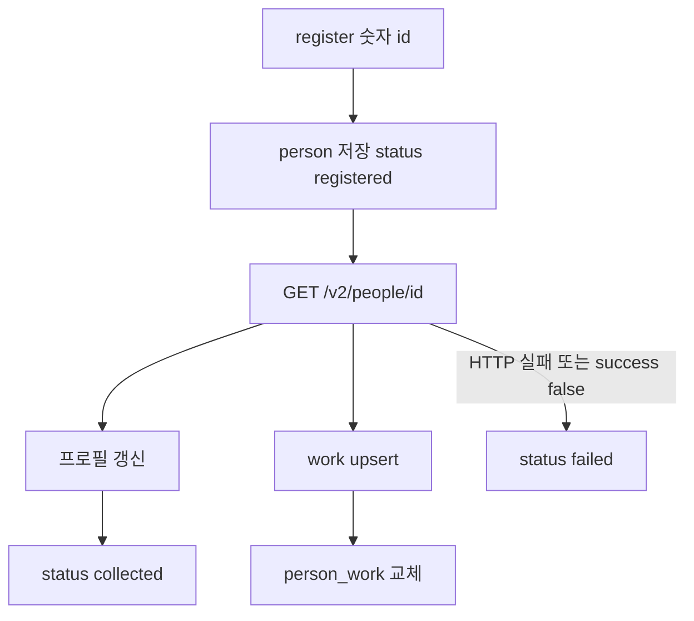

# 1차 구현 설계

기준은 [docs/plan.md](plan.md)의 배우 등록 → 1차 수집이다. 이 문서는 그 흐름을 PostgreSQL과 Python으로 어떻게 실행할지 정한다. 화면은 [docs/hub.md](hub.md)의 hub가 그린다. storage serve는 JSON API다.

## 1차 범위

사용자가 배우의 MDL 숫자 id를 넣고 저장하면 `person` 한 줄이 생긴다. 이어서 kuryana `GET /v2/people/{id}` 한 번으로 프로필과 출연작을 저장한다.

1차에 저장하는 것:

- `person` 프로필
- `work` upsert
- `person_work` 연결

1차 인물 응답만으로 만들지 않는 것:

- 소속사 `person_company`는 kuryana 인물 응답에 없다. Sapphic Effect에서 고른 소속사만 넣는다. 방송사 `company`, `company_type`, `work_company`는 드라마 상세 `original_network`로 만든다.

이유: 2026-11-23에 `GET /v2/people/70935`와 `GET /v2/people/4444`를 호출했다. `data`에 소속사 필드가 없다. Freen 샘플의 `about` 문장에만 "Solenn Entertainment", "IdolFactory"가 있다. `about` 문장을 파싱해 회사를 만들지 않는다.

## 조회키

명령에 배우 이름을 넣지 않는다. 이름은 응답으로 채운다.

MDL 인물 주소는 `https://mydramalist.com/people/70935-freen-sarocha-chankimha`다. `70935`가 인물 id이고 `freen-sarocha-chankimha`는 주소에 붙인 영문 이름이다. 2026-11-23에 `GET /v2/people/70935`와 `GET /v2/people/70935-freen-sarocha-chankimha`가 같은 사람, 같은 `link`를 반환했다.

저장하는 `person.mdl_id`는 숫자만이다. 영문 이름까지 저장하면 MDL이 slug를 바꿀 때 같은 배우가 두 행이 된다.

입력 정규화:

- `70935` → `70935`
- `70935-freen-sarocha-chankimha` → `70935`
- `https://mydramalist.com/people/70935-freen-sarocha-chankimha` → `70935`
- 맨 앞이 숫자가 아니면 저장하지 않고 종료한다

작품도 같다. 응답 slug `40509-persona-2`의 `work.mdl_id`는 `40509`다. 제목은 `work.title`에만 둔다.

## 스택

PostgreSQL. 언어는 Python. 이 수집기는 HTTP JSON을 받아 PostgreSQL에 넣는 작업이라 Python이 맞다.

실행은 JSON API, 화면, CLI다. Docker Compose로 `postgres`, `storage`, `hub`, 수집 CLI `app`을 올린다. 화면 포트와 API 표는 [docs/hub.md](hub.md)에 있다.

MDL 소스는 kuryana (`tbdsux/kuryana`)의 공개 호스트다. `B1PL0/MyDramaList-Unofficial-API`는 쓰지 않는다. 앱은 kuryana를 HTTP로만 호출한다. kuryana 자체 호스팅은 1차 범위 밖이다.

## 프로세스



Compose 파일은 glow 루트의 `docker-compose.yml`이다. 아래 명령은 루트에서 실행한다. 인자는 이름 없는 숫자 id다.

```bash
docker compose run --rm app register 70935
```

1. 정규화한 숫자 id가 없으면 저장하지 않고 종료한다.
2. `person`을 `mdl_id = 숫자 id`로 만든다. 이미 있으면 그 행을 재사용한다. 재실행은 새 행이 아니라 재수집이다.
3. 수집을 시작하기 전에 `collect_status = registered`, `collect_error = null`로 둔다.
4. `GET {KURYANA_BASE_URL}/v2/people/{id}`를 호출한다. `{id}`는 숫자만이다.
5. 성공하면 프로필을 갱신하고, 출연작을 upsert하고, 그 배우의 `person_work`를 이번 응답 기준으로 바꾼 뒤 `collected`로 둔다. 이 경로는 `person_role`에 `a`를 넣는다. kuryana가 Drama 표를 하나만 남기면 인물 페이지의 Drama·Movie 표를 합친다. TV Show는 넣지 않는다. 커밋 뒤 `tmdb_id`가 비어 있는 작품만 TMDB를 찾는다. 상세 `homepage`는 `work.homepage`에 둔다. 그 작품 상세의 네트워크·제작사 이름이 기존 `company.name`과 같으면 빈 `logo_url`, `homepage`만 채우고 타입을 추가한다. 시청처 이름은 회사로 넣거나 재사용하고 `배급사`를 추가한다. `logo_path`는 빈 `logo_url`만 전체 주소로 채운다.
6. 실패하면 행을 지우지 않는다. `failed`와 사유만 남긴다. 이전에 `collected`였던 프로필과 출연작은 그대로 둔다.

배우 목록의 작품 가져오기는 역할 `a`만 다시 수집한다. 진행은 끝낸 수, 전체 수, 지금 이름이다. 2초마다 그 칸과 표의 출연·상태·시각만 바꾼다. 목록 전체를 다시 그리지 않는다.

## 테이블

내부 키는 `bigint` identity. `person.id`, `work.id`, `company.id`는 서로 독립이다.

`work`와 `company`에 `person_id` 컬럼을 두지 않는다. 배우 FK는 `person_work.person_id`, `person_company.person_id`에만 있다.

### person

- `id`
- `mdl_id` text NOT NULL UNIQUE. 숫자만. 예: `70935`. slug의 영문 이름은 저장하지 않는다
- `name`, `native_name`, `first_name`, `family_name` text. 응답으로만 채운다
- `also_known_as` text[]
- `nationality`, `gender` text
- `stage_name` text. `name`에서 `first_name` 앞을 뗀 활동명
- `born_text` text. `November 25, 1999`처럼 `Month D, YYYY`이고 그 날이 맞으면 `1999-11-25`. 이미 `YYYY-MM-DD`면 그대로. 월이 없거나 날이 없으면 원문. 예: `September 22, ????`
- `image_url` text
- `about` text. 배우 등록 수집은 비운다. 작가·감독 가져오기는 `data.about`을 넣는다. `Add Biography`는 넣지 않는다
- `socials` jsonb NOT NULL default `[]`. 항목은 `{kind, url}`. 작가·감독 가져오기 때만 MDL Details의 SNS 줄을 넣는다. 빈 배열이면 기존 값을 덮지 않는다
- `mdl_url` text. 응답 바깥 `link`. 여기에는 영문 이름이 포함된 주소가 들어온다
- `collect_status` text NOT NULL. `registered` | `collected` | `failed`
- `collect_error` text
- `collected_at` timestamptz
- `deleted` smallint NOT NULL default `0`. `0` 노출 · `1` 숨김 · `2` 삭제. 작품과 같다. 행은 지우지 않는다. `deleted ≠ 0`이면 재수집·프로필 덮기를 하지 않는다
- `created_at` timestamptz NOT NULL default `now()`

### role

- `code` text PRIMARY KEY. `a` 배우, `d` 감독, `w` 작가
- `name` text NOT NULL

### person_role

- `person_id` → `person.id`
- `role_code` → `role.code`
- PRIMARY KEY `(person_id, role_code)`

배우 등록은 `a`를 넣는다. 작가·감독 가져오기는 `Director` → `d`, `Screenwriter` → `w`, `Screenwriter & Director` → `d`와 `w`. 이미 `a`인 사람의 프로필은 이 경로가 덮지 않는다. 역할 행은 추가한다. 배우 목록과 작품 가져오기는 `a`만 본다.

### work

- `id`
- `mdl_id` text UNIQUE NULL. 작품 slug의 앞 숫자. 예: slug `40509-persona-2` → `40509`
- `title` text NOT NULL
- `kind` text NOT NULL. 수집은 `drama` | `movie`. `tv_show`는 체크에만 있고 TV Show 표는 넣지 않는다
- `year` int
- `episodes` int
- `rating` numeric
- `mdl_url` text. 응답 `link`. 영문 제목이 붙은 주소
- `aired` text. `Oct 19, 2024 - Jan 4, 2025` → `2024-10-19 ~ 2025-01-04`
- `aired_on` text. 드라마 상세 `aired_on`
- `content_rating` text. `13+ - Teens 13 or older` → `13+`. `18+ Restricted (violence & profanity)` → `18+`. `G - All Ages` → `전체관람가`
- `tmdb_id` bigint NULL. TMDB `movie` 또는 `tv` id. 배우 수집 때 비어 있으면 검색으로 채운다. 사람이 고친 값은 다음 수집에서 유지한다
- `tmdb_kind` text NULL. `movie` | `tv`
- `status` text NULL → `work_status.key`. TMDB `status`. 수집 때 키가 없으면 `name=key`로 넣고 저장한다
- `homepage` text NULL. `GET /3/{movie|tv}/{id}`의 `homepage`. `http://` 또는 `https://`만. 없으면 비운다. 다시 가져오면 그 값으로 바꾼다
- `teaser_url` text NULL. TMDB `videos`에서 YouTube `Teaser` 우선, 없으면 `Trailer`. `official` 우선·최신. `https://www.youtube.com/watch?v={key}`. 없으면 비움. TMDB 삭제 때 함께 비움
- `image_url`, `synopsis`, `native_title` text. `tags` text[]
- `detail_at`, `networks_at`, `air_at` timestamptz. 드라마 상세를 받은 시각. 비어 있으면 작품 화면에서 다시 읽는다
- `deleted` smallint NOT NULL default `0`. `0` 노출 · `1` 숨김(예외) · `2` 삭제. 행은 지우지 않는다. 목록 기본은 `0`(노출). `all`/`0`/`1`/`2`를 고를 수 있다. `deleted ≠ 0`은 상세를 열지 않고, 그 목록 제목은 링크가 아니다. 배우 상세·회사·작가 목록의 작품 목록에서는 `0`만 둔다. 배우 목록의 출연 칸은 보이는 수와 숨긴 수(`deleted ≠ 0`)를 `40(7)`로 보여 준다. 그 수는 작가·감독 역할의 `person_work`를 뺀다. 재수집·TMDB·`upsert_work`는 `deleted = 0`만 내용을 바꾼다. 숨김/삭제 행은 플래그만 유지
- `created_at` timestamptz NOT NULL default `now()`

### work_status

TMDB 작품 상태. 키는 영문 그대로, `name`은 한글.

- `key` text PRIMARY KEY. 예: `Released`, `Ended`
- `name` text NOT NULL. 예: `공개`, `종영`
- 시드: Returning Series→방영중, Planned→예정, In Production→제작중, Post Production→후반작업, Pilot→파일럿, Ended→종영, Canceled→취소, Released→공개, Rumored→루머. 없는 키는 수집 때 `name=key`로 넣는다

### work_provider

TMDB watch providers. 한국 `KR`, 태국 `TH`만. MDL Where to Watch는 저장하지 않는다.

- `work_id` → `work.id`
- `country` text. `KR` | `TH`
- `name` text. 제공처 이름
- `offer` text. `유료 구독` | `Free` | `광고` | `대여` | `구매`
- `url` text NULL. 그 나라 응답의 `link`. 같은 나라 제공처는 같은 주소다
- PRIMARY KEY `(work_id, country, name, offer)`

slug 앞에 숫자가 없는 항목만 `title + year + kind`로 찾는다. 2026-11-23 샘플의 출연작은 전부 `slug`가 있었고, 앞부분은 숫자였다.

### person_work

- `id`
- `person_id` → `person.id`
- `work_id` → `work.id`
- `role` text NOT NULL default `''`. 응답 `role`. 예: `Main Role`, `Guest Role`
- `character_name` text. 응답 `character`
- UNIQUE `(person_id, work_id, role)`

같은 작품에 배우가 여러 명이면 행이 여러 개다. 같은 배우가 같은 작품에서 `role`이 다르면 행이 둘이다. 같은 `role`로 `character`만 다른 항목이 둘이면 1차는 마지막 항목의 `character_name`만 남긴다.

### company

MDL `original_network`는 이름만 넣는다. 같은 `name_key`면 기존 행을 재사용한다.

- `id`
- `name` text NOT NULL
- `name_key` text NOT NULL. 정규화한 이름. 공백은 `_`. `Idol Factory` → `idol_factory`. 회사 매칭키
- `sapphic_slug` text NULL. Sapphic Effect 회사 slug
- `logo_url` text. 전체 주소. 작품 TMDB에서 이름이 같을 때, 또는 시청처 `logo_path`로 빈 값만
- `homepage` text. 작품 TMDB에서 이름이 같을 때 빈 값만
- `created_at` timestamptz NOT NULL default `now()`

### person_company

kuryana 인물 응답은 넣지 않는다. Sapphic Effect에서 고른 소속사는 `relation = agency`로 넣는다.

- `id`
- `person_id` → `person.id`
- `company_id` → `company.id`
- `relation` text NOT NULL default `agency`
- `start_year`, `end_year` integer. `period_text` text. `is_current` boolean NOT NULL default false

### org_type

- `id`
- `name` text NOT NULL UNIQUE. `제작사`, `배급사`, `방송사`, `엔터테이먼트`

### company_type

회사 하나에 타입이 여러 개다.

- `company_id` → `company.id`
- `org_type_id` → `org_type.id`
- PRIMARY KEY `(company_id, org_type_id)`

MDL 방송사 수집은 `방송사`만 붙인다. 작품 TMDB에서 이름이 같은 회사가 `production_companies`에 있으면 `제작사`와 `배급사`를 추가하고, `networks`에 있으면 `방송사`를 추가한다. 그 두 경로는 없는 회사를 만들지 않는다. 시청처 `provider_name`은 `name_key`로 회사를 만들거나 재사용하고 `배급사`를 추가한다. `logo_path`는 전체 이미지 주소로 빈 `logo_url`만 채운다. Sapphic Effect에서 고른 소속사는 `엔터테이먼트`를 추가한다. 이미 있는 타입은 지우지 않는다.

### work_company

- `work_id` → `work.id`
- `company_id` → `company.id`
- PRIMARY KEY `(work_id, company_id)`

MDL `original_network`가 이 연결이다. 그 작품의 연결은 응답으로 교체한다.

## 필드 매핑

호출: `GET /v2/people/{id}`

2026-11-23 실제 응답 형태:

- 바깥: `success`, `data`, `link`, `scraped_at`
- `data`: `name`, `native_name`, `also_known_as`, `nationality`, `gender`, `born`, `age`, `first_name`, `family_name`, `image`, `about`, `works`
- `works`는 종류별 배열. 확인된 키: `Drama`, `Movie`, `TV Show`. 저장은 `Drama`, `Movie`만
- 배열 항목: `title`, `slug`, `link`, `year`, `episodes`, `rating`, `character`, `role`

`also_known_as`는 없을 수 있다. Kim Jong Min 샘플에는 있었고 Freen 샘플에는 없었다. 없으면 빈 배열.

| 응답 | 컬럼 |
| --- | --- |
| 호출에 쓴 숫자 id | `person.mdl_id` |
| `data.name` | `person.name` |
| `data.native_name` | `person.native_name` |
| `data.also_known_as` | `person.also_known_as` |
| `data.nationality` | `person.nationality` |
| `data.gender` | `person.gender` |
| `data.born` | `person.born_text`. `Month D, YYYY`가 맞는 날이면 `YYYY-MM-DD`. 아니면 원문 |
| `data.first_name` | `person.first_name`, `person.stage_name` |
| `data.family_name` | `person.family_name` |
| `data.image` | `person.image_url` |
| `link` | `person.mdl_url` |
| `works.Drama[]` | `work.kind = drama` |
| `works.Movie[]` | `work.kind = movie` |
| 항목 `slug`의 앞 숫자 | `work.mdl_id` |
| 항목 `title` | `work.title` |
| 항목 `year` | `work.year` |
| 항목 `episodes` | `work.episodes` |
| 항목 `rating` | `work.rating` |
| 항목 `link` | `work.mdl_url` |
| 항목 `role` | `person_work.role` |
| 항목 `character` | `person_work.character_name` |

`success != true` 이거나 HTTP가 200이 아니면 프로필과 출연작을 쓰지 않고 `failed`로 둔다. 배우 등록의 `about`은 저장하지 않는다. 작가·감독 가져오기의 `about`은 `person.about`에 둔다. `Add Biography`는 버린다. 회사 추출에 쓰지 않는다. `TV Show`는 읽지 않는다.

## upsert 규칙

한 번의 성공 수집은 트랜잭션 하나다.

1. `work`는 숫자 `mdl_id`가 있으면 그 값으로 upsert한다. 같은 번호면 `title`, `kind`, `year`, `episodes`, `rating`, `mdl_url`만 갱신하고 `work.id`는 유지한다. 다른 배우가 이미 연결한 작품 행을 복제하지 않는다.
2. 숫자 `mdl_id`가 없을 때만 `title + year + kind`로 기존 행을 찾고, 없으면 INSERT한다.
3. 그 배우의 `person_work`는 DELETE 후 이번 `works`로 다시 INSERT한다. 응답에서 빠진 출연은 연결이 사라진다. `work` 행은 지우지 않는다. 다른 배우가 쓸 수 있다.
4. 드라마 상세를 받은 작품은 `original_network`로 `company`, `company_type`(`방송사`), `work_company`를 갱신한다. `person_company`는 건드리지 않는다.

## 상태

| 값 | 의미 |
| --- | --- |
| `registered` | 숫자 id는 저장됐고 이번 수집이 아직 성공하지 않았다 |
| `collected` | 프로필과 출연작 반영이 끝났다 |
| `failed` | 이번 호출이 실패했다. 행은 유지한다 |

실패 사유는 `collect_error`에 HTTP 상태와 응답 `message`만 남긴다. 재시도는 같은 CLI를 다시 실행한다. 자동 재시도 루프는 두지 않는다. 인물 조회 1회 뒤에 필모그래피 표를 합치려고 인물 페이지를 한 번 더 읽는다. 그 페이지를 못 읽으면 kuryana 목록만 쓴다.

## 배우·작품 삭제

상세·목록의 삭제는 `deleted = 2`로 표시만 한다. 연결 행은 지우지 않는다. 배우 삭제는 `person_role`에 `a`가 있을 때만. 없으면 404. 숨김은 `deleted = 1`, 복구는 `deleted = 0`.

## Docker Compose

서비스는 넷이다.

- `postgres`: 공식 PostgreSQL 이미지. 데이터는 named volume. 앱이 붙기 전에 healthy여야 한다. 호스트 포트는 `5433`.
- `storage`: JSON API. 호스트 포트는 `8000`. 기동 때 스키마를 맞춘다.
- `app`: 수집 CLI. 상시 서버가 아니다. glow 루트에서 `docker compose run --rm app register 70935`로 한 번 실행하고 끝난다. `postgres` healthy 이후에 시작한다.
- `hub`: 화면. 호스트 포트는 `3300`. API 주소는 서비스 이름이 아니라 호스트의 `8000`이다.

`register` 뒤의 값은 배우 이름이 아니다. MDL 숫자 id다.

`storage`와 `app`의 DB는 Compose 네트워크의 `postgres`를 본다. hub는 DB에 붙지 않는다. API는 호스트에 열린 `8000`을 본다. kuryana는 컨테이너 밖 HTTP다. Compose 안에 kuryana 서비스를 넣지 않는다.

이미지는 둘이다. `storage/Dockerfile`은 API와 CLI가 같이 쓴다. `hub/Dockerfile`은 화면이고 컨테이너 포트는 `3300`이다.

## 환경변수

- `DATABASE_URL`: 앱이 쓰는 PostgreSQL URL. Compose가 `postgres` 서비스 기준으로 넣는다.
- `POSTGRES_USER`, `POSTGRES_PASSWORD`, `POSTGRES_DB`: `postgres` 서비스 초기화용.
- `KURYANA_BASE_URL`: 기본값 `https://kuryana.tbdh.app`. 끝 슬래시 없이 쓴다. 인물 조회는 `{KURYANA_BASE_URL}/v2/people/{id}`다.
- `tmdb_access_token_auth`: TMDB API 읽기 토큰. `storage/.env`. `storage`와 `app` 컨테이너에 넣는다.
- `HTTP_USER_AGENT`: 위키와 GMMTV 위키, Sapphic Effect 요청 이름. 없으면 `glow-collect/0.1`.

## 범위 밖

- kuryana 자체 호스팅
- 명령 인자로 배우 이름을 받아 검색
- `about`에서 소속사 추출
- MDL Where to Watch, TV Show 표
- 방영 캘린더, 콘서트, 뉴스, 티켓, 수집 스케줄러
