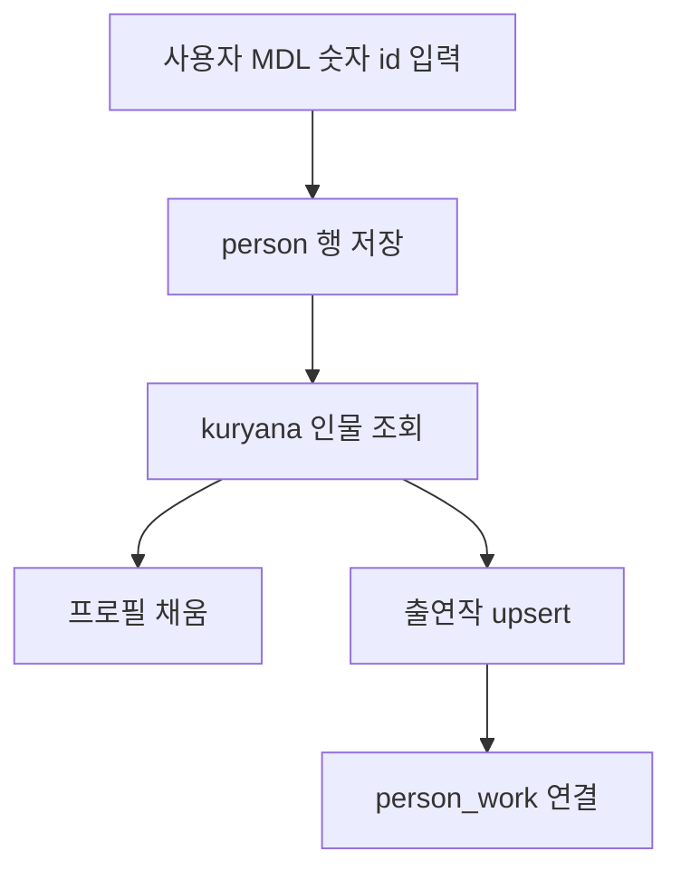

# 태국 엔터 데이터 수집 설계

문서의 줄기는 소스 목록이 아니라 **배우 등록 → 1차 수집**이다. 실행 방법, 테이블 컬럼, Docker Compose는 [docs/design.md](design.md)에 있다.

위키(영어, 없으면 프랑스어), Sapphic Effect, TMDB 시청처·작품 홈페이지와 회사 로고는 지금 앱에 있다. 캘린더, 뉴스, 티켓은 아직 없다.

## 문서가 답하는 것

- 수집은 사용자가 배우의 MDL 숫자 id를 넣고 저장할 때 시작된다
- 저장 직후 1차 수집은 프로필과 출연 작품이다. 소속사 테이블은 만들어 두고 행은 비운다
- `person` / `work` / `company` 를 어떤 키로 연결하는지
- 1차 API는 kuryana 인물 조회 하나다
- 하면 안 되는 것: 배우 이름을 조회키로 쓰기, MDL 주소를 테이블 사이 FK로 쓰기, 작품·소속사 테이블에 배우 id를 두기, `about` 문장에서 회사를 뽑기, Cloudflare 우회, MDL Where to Watch와 TV Show를 읽기

## 1. 수집 플로우

1. 사용자가 배우의 MDL 숫자 id를 입력하고 저장한다. 예: `70935`. 이 행이 배우 관리의 시작이다. 숫자가 없으면 저장하지 않는다.
2. MDL 주소의 인물 slug는 `70935-freen-sarocha-chankimha`처럼 숫자 뒤에 영문 이름이 붙는다. 그 이름은 사람이 읽으라고 붙은 것이고 조회키가 아니다. `70935`만으로 `GET /v2/people/70935`가 같은 사람을 반환한다. 저장하는 `person.mdl_id`는 숫자만이다. 사용자가 slug나 주소 전체를 붙여넣으면 맨 앞 숫자만 남긴다.
3. 저장되면 수집 상태가 `registered`인 `person` 한 줄만 생긴다. 프로필 필드는 비어 있다. 이름은 이 시점의 입력이 아니다. 응답의 `name`, `native_name`으로 채운다.
4. 1차 수집이 그 숫자 id로 kuryana 인물 API를 호출한다.
5. 같은 응답에서 두 갈래로 나눈다.
   - 프로필: 본명, 영문/태국어 이름, 생년월일, 국적, 사진 URL → `person` 갱신
   - 출연작: 작품 slug `40509-persona-2`에서도 앞 숫자 `40509`만 `work.mdl_id`로 쓴다. 이미 있으면 기존 `work.id`를 재사용하고 `person_work` 한 줄을 추가한다. 배역명, 주연/조연은 연결 행에 둔다
6. 1차 성공 시 상태를 `collected`로 바꾼다. 실패해도 `person` 행은 지우지 않고 `failed`와 사유만 남긴다. 같은 숫자 id 재등록은 새 행이 아니라 그 행의 재수집이다. 배우 등록은 `person_role` `a`를 넣는다. 배우 목록의 작품 가져오기는 `a`만 같은 수집으로 다시 돌린다. 진행은 끝낸 수, 전체 수, 지금 이름이고, 2초마다 그 칸과 출연·상태·시각만 바꾼다. 배우 상세에서 삭제하면 `a`인 사람과 그 연결만 지운다. 작품·회사 행은 남긴다.

소속사는 kuryana 응답에 필드가 없다. `about` 문장에 회사 이름이 있어도 파싱하지 않는다. Sapphic Effect에서 고른 소속사만 `person_company`에 넣고 `엔터테이먼트` 타입을 추가한다.

배우 수집 때 하지 않는 것: 에피소드 상세, 방영 캘린더, 콘서트, 뉴스, 제작사 계열 구조. 에피소드는 작품 화면 버튼이다. 영화 상세에는 에피소드 칸을 두지 않는다. 위키는 배우 화면에서 고른다. 영어 인물 문서가 없으면 프랑스어를 찾는다. TMDB 시청처는 `tmdb_id`가 비어 있는 작품만 수집 뒤에 채운다. 그때 작품의 네트워크·제작사 이름이 기존 회사와 같으면 빈 로고·홈페이지와 타입만 채운다. TMDB 회사 id와 네트워크 id는 저장하지 않는다.

## 2. 연결 키

**작품·소속사 테이블에는 배우 id 컬럼이 없다.** 한 작품·한 회사에 배우가 여러 명이므로, 배우 FK를 `work` / `company`에 두면 한 명만 남는다. 배우 id FK는 연결 테이블 행에만 있다. 배우가 늘면 작품/회사 행을 복제하지 않고 연결 행만 추가한다.

- `person.id`, `work.id`, `company.id`: 각자 독립 대리키. 구현은 `bigint` identity. [docs/design.md](design.md)
- `work` upsert 키는 작품의 MDL 숫자 id다. 숫자 id가 없으면 제목+연도+종류. 이미 있으면 그 `work.id`를 재사용한다
- `company` upsert 키는 정규화한 `name_key`다
- 연결 테이블이 다대다를 만든다. 여기의 `person_id`가 배우 FK다
  - `person_work.person_id` → `person.id`
  - `person_work.work_id` → `work.id`
  - 유니크: `(person_id, work_id, role)` — 같은 작품, 다른 배우 = 행이 여러 개. 같은 배우의 다른 배역도 행이 둘
  - `person_company.person_id` → `person.id`
  - `person_company.company_id` → `company.id`
  - relation 값은 `agency`(소속). 기간은 `start_year`, `end_year`, `period_text`, `is_current`. 같은 회사, 다른 배우 = 행이 여러 개. 작품의 제작사는 여기 넣지 않는다
- 외부 키는 FK가 아니다. 각 테이블 컬럼 + UNIQUE
  - `person.mdl_id` UNIQUE NOT NULL — 사용자 입력에서 뽑은 숫자 id. 수집 조회키
  - `work.mdl_id` UNIQUE NULL — 출연작 slug의 앞 숫자. 없을 때만 비운다
- 회사는 이름만 온다. 정규화한 `name_key`로 upsert한다. 이름 문자열 자체를 FK로 쓰지 않는다
- 제작사(`work`를 만든 회사)와 소속사(배우가 속한 회사)는 다른 관계다. 방송사 연결 `work_company`는 MDL `original_network`다. 타입 이름은 `org_type`이다. 이름은 `제작사`, `배급사`, `방송사`, `엔터테인먼트`. 회사와의 연결은 `company_type (company_id, org_type_id)`. 한 회사에 여러 개다. MDL은 `방송사`만 붙인다. 작품 TMDB의 `production_companies`에 같은 이름이 있으면 `제작사`와 `배급사`를 추가하고, `networks`에 있으면 `방송사`를 추가한다. 그 경로는 없는 회사를 만들지 않는다. 시청처 이름은 회사를 만들거나 재사용하고 `배급사`를 추가한다. `logo_path`는 빈 로고만 전체 주소로 채운다. Sapphic Effect 소속사는 `엔터테이먼트`를 추가한다

MDL 숫자 id를 공통 FK로 쓰지 않는 이유: 배우 번호와 작품 번호는 다른 체계다. 소속사는 번호 없이 이름만 오는 경우가 있다. 나중에 TMDB·위키에서 만든 행에는 MDL 번호가 없다. 주소의 영문 이름 부분이 바뀌어도 내부 id 연결은 유지된다.

## 3. 1차 소스

kuryana (`tbdsux/kuryana`) 공개 호스트. `GET /v2/people/{id}`. `B1PL0/MyDramaList-Unofficial-API`는 쓰지 않는다. kuryana 자체 호스팅은 1차 범위 밖이다.

1차 입력은 `person.mdl_id` 하나. 쓰는 응답 필드:

- 인물: 이름들, 생일, 국적, 사진. 배우는 `about`을 저장하지 않는다. 작가·감독 수집은 `about`과 Details SNS를 저장한다
- 필모: 작품 slug, 제목, 종류(드라마/영화/TV 쇼), 연도, 배역

Where to Watch와 TV Show는 읽지 않는다. kuryana가 Drama 표를 하나만 남기므로 인물 페이지의 Drama·Movie 표만 합친다. 그 페이지를 못 읽으면 kuryana 목록을 쓴다. Cloudflare 우회 절차는 두지 않는다.

## 4. 2차 이후

이미 있는 것: 드라마 상세·에피소드, Sapphic Effect 소속사, 위키 인포박스(영어, 없으면 프랑스어), GMMTV 위키, TMDB 시청처, 작품 TMDB `homepage`, 작품 TMDB로 채우는 회사 로고, 역할 `a`/`d`/`w`, 배우 삭제.

아직 없는 것:

- 작품 보강: 포스터·방영 연도를 TMDB에서 채우기, OMDb 평점. IMDb 페이지 크롤은 제외
- 인물 보강: TMDB person, `th` 위키 인포박스
- 회사 보강: Wikidata `P749`/`P355`
- 일정: World of BL, Watcher, Sapphic Signal, GL Spotlight, 티켓 3사(ThaiTicketMajor, All Ticket, Ticketmelon). 공개 목록의 일시·장소·제목만
- 동향: Google News RSS, 회사 YouTube 채널 신규 영상
- 키노라이츠는 한국 OTT 여부가 필요할 때만. 수집 파이프라인에 넣지 않음

시드 회사 목록(GMMTV, CHANGE2561, Idol Factory, Domundi, Be On Cloud, GDH, Channel 3/7, Workpoint, MGI 등)은 2차 회사 매칭용 별칭 표로만 둔다. 수집 시작 시드가 아니다.

## 범위 밖

- SQL DDL, 마이그레이션, 스케줄러 코드. 컬럼 목록은 [docs/design.md](design.md)
- 크롤러 셀렉터, Cloudflare 우회
- 1차 플로우에 캘린더·뉴스·티켓을 끼워 넣는 설계
