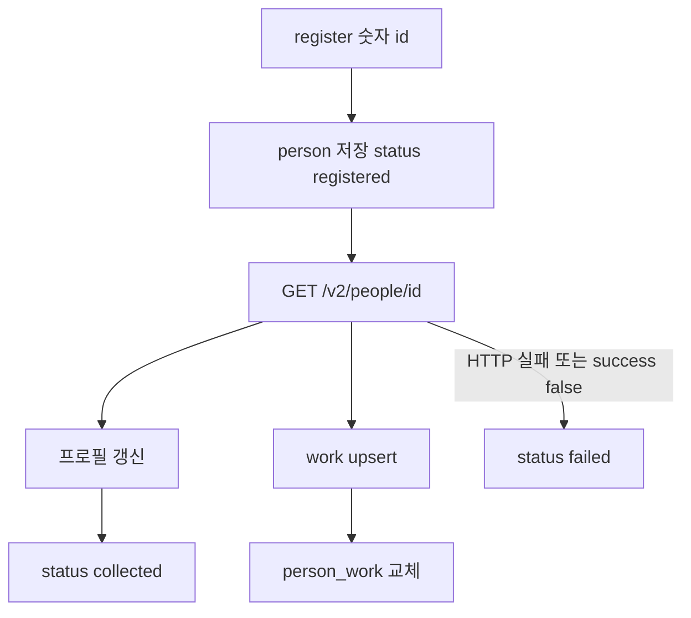

# 1차 구현 설계

기준은 [storage/plan.md](plan.md)의 배우 등록 → 1차 수집이다. 이 문서는 그 흐름을 PostgreSQL과 Python으로 어떻게 실행할지 정한다.

## 1차 범위

사용자가 배우의 MDL 숫자 id를 넣고 저장하면 `person` 한 줄이 생긴다. 이어서 kuryana `GET /v2/people/{id}` 한 번으로 프로필과 출연작을 저장한다.

1차에 저장하는 것:

- `person` 프로필
- `work` upsert
- `person_work` 연결

1차에 행을 만들지 않는 것:

- `company`, `person_company`. 테이블만 만든다. 소속사 행은 비운다.

이유: 2026-11-23에 `GET /v2/people/70935`와 `GET /v2/people/4444`를 호출했다. `data`에 소속사 필드가 없다. Freen 샘플의 `about` 문장에만 "Solenn Entertainment", "IdolFactory"가 있다. `about` 문장을 파싱해 회사를 만들지 않는다.

## 조회키

명령에 배우 이름을 넣지 않는다. 이름은 응답으로 채운다.

MDL 인물 주소는 `https://mydramalist.com/people/70935-freen-sarocha-chankimha`다. `70935`가 인물 id이고 `freen-sarocha-chankimha`는 주소에 붙인 영문 이름이다. 2026-11-23에 `GET /v2/people/70935`와 `GET /v2/people/70935-freen-sarocha-chankimha`가 같은 사람, 같은 `link`를 반환했다.

저장하는 `person.mdl_id`는 숫자만이다. 영문 이름까지 저장하면 MDL이 slug를 바꿀 때 같은 배우가 두 행이 된다.

입력 정규화:

- `70935` → `70935`
- `70935-freen-sarocha-chankimha` → `70935`
- `https://mydramalist.com/people/70935-freen-sarocha-chankimha` → `70935`
- 맨 앞이 숫자가 아니면 저장하지 않고 종료한다

작품도 같다. 응답 slug `40509-persona-2`의 `work.mdl_id`는 `40509`다. 제목은 `work.title`에만 둔다.

## 스택

PostgreSQL. 언어는 Python. 이 수집기는 HTTP JSON을 받아 PostgreSQL에 넣는 작업이라 Python이 맞다.

1차 실행 형태는 웹 서버가 아니라 CLI다. Docker Compose로 `postgres`와 수집 앱을 올린다.

MDL 소스는 kuryana (`tbdsux/kuryana`)의 공개 호스트다. `B1PL0/MyDramaList-Unofficial-API`는 쓰지 않는다. 앱은 kuryana를 HTTP로만 호출한다. kuryana 자체 호스팅은 1차 범위 밖이다.

## 프로세스



Compose 파일은 `storage/docker-compose.yml`이다. 아래 명령은 `storage`에서 실행한다. 인자는 이름 없는 숫자 id다.

```bash
docker compose run --rm app register 70935
```

1. 정규화한 숫자 id가 없으면 저장하지 않고 종료한다.
2. `person`을 `mdl_id = 숫자 id`로 만든다. 이미 있으면 그 행을 재사용한다. 재실행은 새 행이 아니라 재수집이다.
3. 수집을 시작하기 전에 `collect_status = registered`, `collect_error = null`로 둔다.
4. `GET {KURYANA_BASE_URL}/v2/people/{id}`를 호출한다. `{id}`는 숫자만이다.
5. 성공하면 프로필을 갱신하고, 출연작을 upsert하고, 그 배우의 `person_work`를 이번 응답 기준으로 바꾼 뒤 `collected`로 둔다.
6. 실패하면 행을 지우지 않는다. `failed`와 사유만 남긴다. 이전에 `collected`였던 프로필과 출연작은 그대로 둔다.

## 테이블

내부 키는 `bigint` identity. `person.id`, `work.id`, `company.id`는 서로 독립이다.

`work`와 `company`에 `person_id` 컬럼을 두지 않는다. 배우 FK는 `person_work.person_id`, `person_company.person_id`에만 있다.

### person

- `id`
- `mdl_id` text NOT NULL UNIQUE. 숫자만. 예: `70935`. slug의 영문 이름은 저장하지 않는다
- `name`, `native_name`, `first_name`, `family_name` text. 응답으로만 채운다
- `also_known_as` text[]
- `nationality`, `gender` text
- `born_text` text. 응답 `born`은 `"September 24, 1979"` 같은 문장이다. 1차는 파싱하지 않는다
- `age` int
- `image_url`, `about` text
- `mdl_url` text. 응답 바깥 `link`. 여기에는 영문 이름이 포함된 주소가 들어온다
- `collect_status` text NOT NULL. `registered` | `collected` | `failed`
- `collect_error` text
- `collected_at` timestamptz
- `created_at` timestamptz NOT NULL default `now()`

### work

- `id`
- `mdl_id` text UNIQUE NULL. 작품 slug의 앞 숫자. 예: slug `40509-persona-2` → `40509`
- `title` text NOT NULL
- `kind` text NOT NULL. `drama` | `movie` | `tv_show`
- `year` int
- `episodes` int
- `rating` numeric
- `mdl_url` text. 응답 `link`. 영문 제목이 붙은 주소
- `created_at` timestamptz NOT NULL default `now()`

slug 앞에 숫자가 없는 항목만 `title + year + kind`로 찾는다. 2026-11-23 샘플의 출연작은 전부 `slug`가 있었고, 앞부분은 숫자였다.

### person_work

- `id`
- `person_id` → `person.id`
- `work_id` → `work.id`
- `role` text NOT NULL default `''`. 응답 `role`. 예: `Main Role`, `Guest Role`
- `character_name` text. 응답 `character`
- UNIQUE `(person_id, work_id, role)`

같은 작품에 배우가 여러 명이면 행이 여러 개다. 같은 배우가 같은 작품에서 `role`이 다르면 행이 둘이다. 같은 `role`로 `character`만 다른 항목이 둘이면 1차는 마지막 항목의 `character_name`만 남긴다.

### company

스키마만 둔다. 1차 수집은 INSERT하지 않는다.

- `id`
- `mdl_id` text UNIQUE NULL. 값이 생기면 숫자만
- `name` text NOT NULL
- `name_key` text NOT NULL. 정규화한 이름. `mdl_id`가 없을 때의 매칭키
- `match_status` text NOT NULL default `name_only`
- `created_at` timestamptz NOT NULL default `now()`

### person_company

스키마만 둔다. 1차 수집은 INSERT하지 않는다.

- `id`
- `person_id` → `person.id`
- `company_id` → `company.id`
- `relation` text NOT NULL default `agency`
- UNIQUE `(person_id, company_id, relation)`

제작사 연결 `work_company`는 1차에 만들지 않는다.

## 필드 매핑

호출: `GET /v2/people/{id}`

2026-11-23 실제 응답 형태:

- 바깥: `success`, `data`, `link`, `scraped_at`
- `data`: `name`, `native_name`, `also_known_as`, `nationality`, `gender`, `born`, `age`, `first_name`, `family_name`, `image`, `about`, `works`
- `works`는 종류별 배열. 확인된 키: `Drama`, `Movie`, `TV Show`
- 배열 항목: `title`, `slug`, `link`, `year`, `episodes`, `rating`, `character`, `role`

`also_known_as`는 없을 수 있다. Kim Jong Min 샘플에는 있었고 Freen 샘플에는 없었다. 없으면 빈 배열.

| 응답 | 컬럼 |
| --- | --- |
| 호출에 쓴 숫자 id | `person.mdl_id` |
| `data.name` | `person.name` |
| `data.native_name` | `person.native_name` |
| `data.also_known_as` | `person.also_known_as` |
| `data.nationality` | `person.nationality` |
| `data.gender` | `person.gender` |
| `data.born` | `person.born_text` |
| `data.age` | `person.age` |
| `data.first_name` | `person.first_name` |
| `data.family_name` | `person.family_name` |
| `data.image` | `person.image_url` |
| `data.about` | `person.about` |
| `link` | `person.mdl_url` |
| `works.Drama[]` | `work.kind = drama` |
| `works.Movie[]` | `work.kind = movie` |
| `works.TV Show[]` | `work.kind = tv_show` |
| 항목 `slug`의 앞 숫자 | `work.mdl_id` |
| 항목 `title` | `work.title` |
| 항목 `year` | `work.year` |
| 항목 `episodes` | `work.episodes` |
| 항목 `rating` | `work.rating` |
| 항목 `link` | `work.mdl_url` |
| 항목 `role` | `person_work.role` |
| 항목 `character` | `person_work.character_name` |

`success != true` 이거나 HTTP가 200이 아니면 프로필과 출연작을 쓰지 않고 `failed`로 둔다. `about`은 프로필 본문으로만 저장한다. 회사 추출에 쓰지 않는다.

## upsert 규칙

한 번의 성공 수집은 트랜잭션 하나다.

1. `work`는 숫자 `mdl_id`가 있으면 그 값으로 upsert한다. 같은 번호면 `title`, `kind`, `year`, `episodes`, `rating`, `mdl_url`만 갱신하고 `work.id`는 유지한다. 다른 배우가 이미 연결한 작품 행을 복제하지 않는다.
2. 숫자 `mdl_id`가 없을 때만 `title + year + kind`로 기존 행을 찾고, 없으면 INSERT한다.
3. 그 배우의 `person_work`는 DELETE 후 이번 `works`로 다시 INSERT한다. 응답에서 빠진 출연은 연결이 사라진다. `work` 행은 지우지 않는다. 다른 배우가 쓸 수 있다.
4. `company`, `person_company`는 이 트랜잭션에서 건드리지 않는다.

## 상태

| 값 | 의미 |
| --- | --- |
| `registered` | 숫자 id는 저장됐고 이번 수집이 아직 성공하지 않았다 |
| `collected` | 프로필과 출연작 반영이 끝났다 |
| `failed` | 이번 호출이 실패했다. 행은 유지한다 |

실패 사유는 `collect_error`에 HTTP 상태와 응답 `message`만 남긴다. 재시도는 같은 CLI를 다시 실행한다. 자동 재시도 루프는 두지 않는다. 요청은 등록 1회당 인물 조회 1회다.

## Docker Compose

서비스는 둘이다.

- `postgres`: 공식 PostgreSQL 이미지. 데이터는 named volume. 앱이 붙기 전에 healthy여야 한다.
- `app`: 수집 CLI 이미지. 상시 서버가 아니다. `storage`에서 `docker compose run --rm app register 70935`로 한 번 실행하고 끝난다. `postgres` healthy 이후에 시작한다.

`register` 뒤의 값은 배우 이름이 아니다. MDL 숫자 id다.

앱 컨테이너의 DB는 Compose 네트워크의 `postgres`를 본다. kuryana는 컨테이너 밖 HTTP다. Compose 안에 kuryana 서비스를 넣지 않는다.

이미지 빌드는 `app` 서비스의 build 한 줄로만 적는다. Dockerfile 내용은 이 문서에 두지 않는다.

## 환경변수

- `DATABASE_URL`: 앱이 쓰는 PostgreSQL URL. Compose가 `postgres` 서비스 기준으로 넣는다.
- `POSTGRES_USER`, `POSTGRES_PASSWORD`, `POSTGRES_DB`: `postgres` 서비스 초기화용.
- `KURYANA_BASE_URL`: 기본값 `https://kuryana.tbdh.app`. 끝 슬래시 없이 쓴다. 인물 조회는 `{KURYANA_BASE_URL}/v2/people/{id}`다.

## 범위 밖

- kuryana 자체 호스팅, MDL HTML 직접 수집
- 명령 인자로 배우 이름을 받아 검색
- `about`에서 소속사 추출, `company` / `person_company` INSERT
- 에피소드, 방영 캘린더, 콘서트, 뉴스, TMDB, 위키, 티켓
- 웹 화면, 수집 스케줄러, 자동 재시도
- `work_company`
