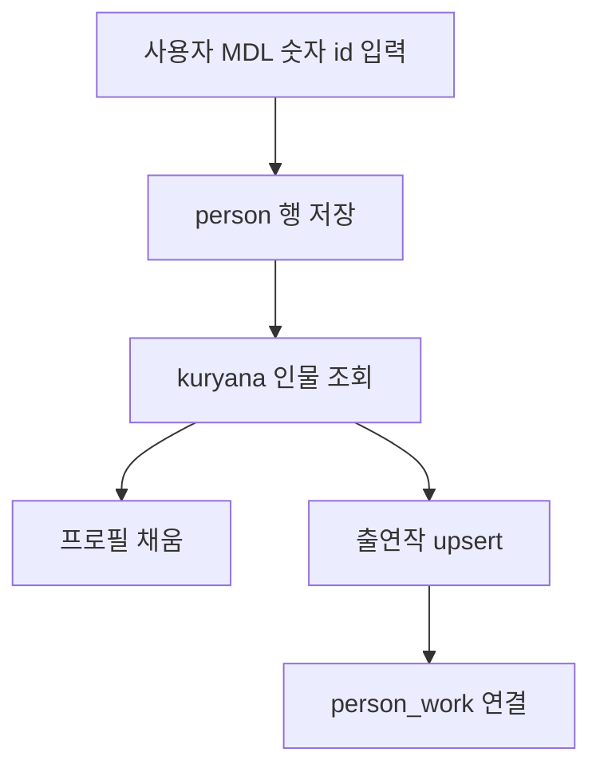

# 태국 엔터 데이터 수집 설계

문서의 줄기는 소스 목록이 아니라 **배우 등록 → 1차 수집**이다. 실행 방법, 테이블 컬럼, Docker Compose는 [storage/design.md](design.md)에 있다.

TMDB, 위키, 캘린더, 뉴스, 티켓은 1차 이후 보강이다.

## 문서가 답하는 것

- 수집은 사용자가 배우의 MDL 숫자 id를 넣고 저장할 때 시작된다
- 저장 직후 1차 수집은 프로필과 출연 작품이다. 소속사 테이블은 만들어 두고 행은 비운다
- `person` / `work` / `company` 를 어떤 키로 연결하는지
- 1차 API는 kuryana 인물 조회 하나다
- 하면 안 되는 것: 배우 이름을 조회키로 쓰기, MDL 주소를 테이블 사이 FK로 쓰기, 작품·소속사 테이블에 배우 id를 두기, `about` 문장에서 회사를 뽑기, Cloudflare 우회, 직접 MDL HTML 크롤

## 1. 수집 플로우

1. 사용자가 배우의 MDL 숫자 id를 입력하고 저장한다. 예: `70935`. 이 행이 배우 관리의 시작이다. 숫자가 없으면 저장하지 않는다.
2. MDL 주소의 인물 slug는 `70935-freen-sarocha-chankimha`처럼 숫자 뒤에 영문 이름이 붙는다. 그 이름은 사람이 읽으라고 붙은 것이고 조회키가 아니다. `70935`만으로 `GET /v2/people/70935`가 같은 사람을 반환한다. 저장하는 `person.mdl_id`는 숫자만이다. 사용자가 slug나 주소 전체를 붙여넣으면 맨 앞 숫자만 남긴다.
3. 저장되면 수집 상태가 `registered`인 `person` 한 줄만 생긴다. 프로필 필드는 비어 있다. 이름은 이 시점의 입력이 아니다. 응답의 `name`, `native_name`으로 채운다.
4. 1차 수집이 그 숫자 id로 kuryana 인물 API를 호출한다.
5. 같은 응답에서 두 갈래로 나눈다.
   - 프로필: 본명, 영문/태국어 이름, 생년월일, 국적, 사진 URL → `person` 갱신
   - 출연작: 작품 slug `40509-persona-2`에서도 앞 숫자 `40509`만 `work.mdl_id`로 쓴다. 이미 있으면 기존 `work.id`를 재사용하고 `person_work` 한 줄을 추가한다. 배역명, 주연/조연은 연결 행에 둔다
6. 1차 성공 시 상태를 `collected`로 바꾼다. 실패해도 `person` 행은 지우지 않고 `failed`와 사유만 남긴다. 같은 숫자 id 재등록은 새 행이 아니라 그 행의 재수집이다.

소속사는 1차 응답에 필드가 없다. `about` 문장에 회사 이름이 있어도 파싱하지 않는다. `company`, `person_company`는 나중을 위해 스키마만 둔다.

1차에서 하지 않는 것: 소속사 행 생성, 에피소드 상세, 방영 캘린더, 콘서트, 뉴스, TMDB/위키 매칭, 제작사 계열 구조.

## 2. 연결 키

**작품·소속사 테이블에는 배우 id 컬럼이 없다.** 한 작품·한 회사에 배우가 여러 명이므로, 배우 FK를 `work` / `company`에 두면 한 명만 남는다. 배우 id FK는 연결 테이블 행에만 있다. 배우가 늘면 작품/회사 행을 복제하지 않고 연결 행만 추가한다.

- `person.id`, `work.id`, `company.id`: 각자 독립 대리키. 구현은 `bigint` identity. [storage/design.md](design.md)
- `work` upsert 키는 작품의 MDL 숫자 id다. 숫자 id가 없으면 제목+연도+종류. 이미 있으면 그 `work.id`를 재사용한다
- `company` upsert 키는 `company.mdl_id` 또는 정규화 이름. 1차에서는 이 upsert를 하지 않는다
- 연결 테이블이 다대다를 만든다. 여기의 `person_id`가 배우 FK다
  - `person_work.person_id` → `person.id`
  - `person_work.work_id` → `work.id`
  - 유니크: `(person_id, work_id, role)` — 같은 작품, 다른 배우 = 행이 여러 개. 같은 배우의 다른 배역도 행이 둘
  - `person_company.person_id` → `person.id`
  - `person_company.company_id` → `company.id`
  - 유니크: `(person_id, company_id, relation)` — relation 값은 `agency`(소속). 같은 회사, 다른 배우 = 행이 여러 개. 작품의 제작사는 여기 넣지 않는다
- 외부 키는 FK가 아니다. 각 테이블 컬럼 + UNIQUE
  - `person.mdl_id` UNIQUE NOT NULL — 사용자 입력에서 뽑은 숫자 id. 수집 조회키
  - `work.mdl_id` UNIQUE NULL — 출연작 slug의 앞 숫자. 없을 때만 비운다
  - `company.mdl_id` UNIQUE NULL — MDL이 회사 숫자 id를 줄 때만
- 소속사를 나중에 이름만으로 넣으면 `company.mdl_id`를 비우고, 정규화한 이름을 임시 매칭키로 upsert한다. 그 행은 `match_status=name_only`. 이름 문자열 자체를 FK로 쓰지 않는다
- 제작사(`work`를 만든 회사)와 소속사(배우가 속한 회사)는 다른 관계다. 제작사 연결 `work_company`는 2차다

MDL 숫자 id를 공통 FK로 쓰지 않는 이유: 배우 번호와 작품 번호는 다른 체계다. 소속사는 번호 없이 이름만 오는 경우가 있다. 나중에 TMDB·위키에서 만든 행에는 MDL 번호가 없다. 주소의 영문 이름 부분이 바뀌어도 내부 id 연결은 유지된다.

## 3. 1차 소스

kuryana (`tbdsux/kuryana`) 공개 호스트. `GET /v2/people/{id}`. `B1PL0/MyDramaList-Unofficial-API`는 쓰지 않는다. kuryana 자체 호스팅은 1차 범위 밖이다.

1차 입력은 `person.mdl_id` 하나. 쓰는 응답 필드:

- 인물: 이름들, 생일, 국적, 사진, `about`
- 필모: 작품 slug, 제목, 종류(드라마/영화/TV 쇼), 연도, 배역

직접 MDL HTML 크롤은 안 한다. Cloudflare 우회 절차는 두지 않는다. 요청은 등록 1회당 인물 조회 1회다.

## 4. 2차 이후

1차가 만든 내부 id 위에 외부 키를 채운다.

- 소속사: 사람 응답 밖의 출처가 생긴 뒤에 `company`, `person_company`를 채운다
- 작품 보강: `work.mdl_id`로 MDL 드라마 상세·에피소드. 포스터·방영 연도는 TMDB. 평점 문자열은 OMDb. IMDb 페이지 크롤은 제외
- 인물 보강: TMDB person, `th`/`en` 위키 인포박스
- 회사 보강: 이름 매칭으로 Wikidata `P749`/`P355`, TMDB company id. `match_status=name_only`인 행만 대상
- 일정: World of BL, Watcher, Sapphic Signal, GL Spotlight, 티켓 3사(ThaiTicketMajor, All Ticket, Ticketmelon). 공개 목록의 일시·장소·제목만
- 동향: Google News RSS, 회사 YouTube 채널 신규 영상
- 키노라이츠는 한국 OTT 여부가 필요할 때만. 1차 파이프라인에 넣지 않음

시드 회사 목록(GMMTV, CHANGE2561, Idol Factory, Domundi, Be On Cloud, GDH, Channel 3/7, Workpoint, MGI 등)은 2차 회사 매칭용 별칭 표로만 둔다. 수집 시작 시드가 아니다.

## 범위 밖

- SQL DDL, 마이그레이션, 스케줄러 코드. 컬럼 목록은 [storage/design.md](design.md)
- 크롤러 셀렉터, Cloudflare 우회
- 1차 플로우에 캘린더·뉴스·티켓을 끼워 넣는 설계
